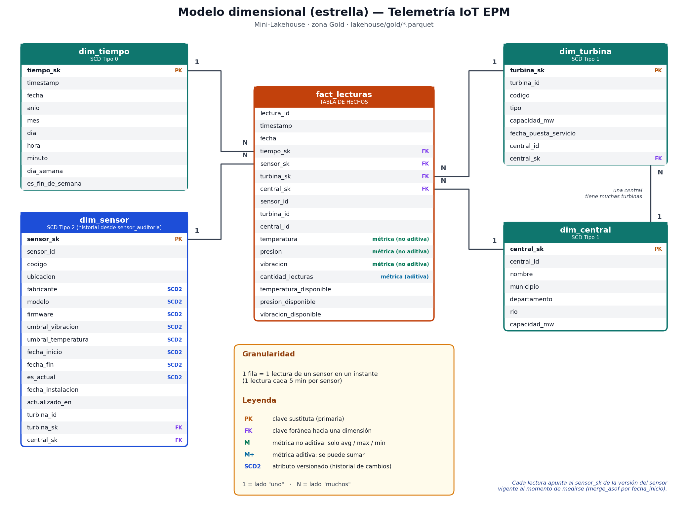

# Telemetría IoT EPM — Mini-Lakehouse

Taller 3 · Tópicos Avanzados en Bases de Datos · ITM 2026

## Descripción

Capa analítica de la Arquitectura Lambda propuesta para EPM (Hidroituango, Guatapé y Porce III).
Un simulador de sensores IoT alimenta una base operacional (OLTP); sus datos se copian a un lakehouse
con zonas Bronze / Silver / Gold en Parquet, consultado con DuckDB.

## Estado del proyecto

| Zona | Responsable | Estado | Scripts |
|---|---|---|---|
| Simulación OLTP + Bronze | Juan Camilo Gutierrez Medina | Listo | `generar_oltp.py`, `extract.py`, `verificar_bronze.py` |
| Silver | Jenny Elizabeth Medina | Implementado y validado | `transform_silver.py` |
| Gold | Andrés Valderrama Acero | Implementado y validado | `transform_gold.py` |
| Análisis y benchmark | Andrés Valderrama Acero | Implementado y validado | `analyze.py` |

## Requisitos

- Python 3.10 o superior
- No necesita ninguna base de datos instalada: la fuente operacional se simula en SQLite.

## Cómo ejecutar

```bash
git clone https://github.com/<usuario>/<repositorio>.git
cd <repositorio>
python -m venv .venv
.venv\Scripts\activate          # Mac/Linux: source .venv/bin/activate
pip install -r requirements.txt
python main.py
```

Cada ejecución de `python main.py`:
1. Simula que los sensores envían 6 horas nuevas de lecturas aleatorias (la primera vez, 3 días de historia).
2. Extrae a Bronze solo las lecturas nuevas.
3. Verifica Bronze y actualiza `docs/perfil_bronze.txt`.
4. Limpia a Silver, construye el modelo dimensional en Gold y ejecuta las consultas y el benchmark.

Otros comandos útiles:

| Comando | Qué hace |
|---|---|
| `python main.py --reset` | Borra `lakehouse/` y la base simulada; empieza de cero |
| `python scripts/generar_oltp.py --horas 24` | Agrega 24 horas de lecturas |
| `python scripts/generar_oltp.py --en-vivo 30` | Durante 30 s llega una lectura por sensor cada 2 s |
| `python scripts/verificar_bronze.py` | Controles y perfil de calidad de Bronze |
| `python scripts/transform_gold.py` | Reconstruye solo el modelo dimensional Gold |
| `python scripts/analyze.py` | Ejecuta solo las consultas analíticas y el benchmark |

Parámetros (variables de entorno): `EPM_FRECUENCIA_MIN` (5), `EPM_DIAS_INICIALES` (3), `EPM_HORAS` (6),
`EPM_SEMILLA` (vacío = aleatorio).

## Estructura

```
├── lakehouse/
│   ├── bronze/               datos crudos en Parquet
│   ├── silver/               datos limpios, cuarentenas e informes
│   └── gold/                 modelo estrella en Parquet
├── oltp/                     base operacional simulada
├── scripts/
│   ├── config.py             rutas y parámetros compartidos
│   ├── utilidades.py         funciones comunes
│   ├── generar_oltp.py       simulador de sensores
│   ├── extract.py            OLTP -> Bronze
│   ├── verificar_bronze.py   controles de calidad de Bronze
│   ├── transform_silver.py   transformación Bronze -> Silver
│   ├── transform_gold.py     transformación Silver -> Gold (modelo dimensional)
│   └── analyze.py            consultas analíticas + benchmark
├── docs/
│   ├── perfil_bronze.txt     perfil de calidad de Bronze
│   ├── modelo_dimensional.png  diagrama del modelo estrella
│   ├── resultados_consultas.txt  salida de las consultas analíticas
│   ├── benchmark.md / .csv   resultados del benchmark
├── main.py                  ejecuta el pipeline
└── requirements.txt
```

## Zona Bronze

**Fuente simulada:** 3 centrales, 20 turbinas y 80 sensores; 1 lectura cada 5 minutos por sensor.
Mismas tablas del entregable anterior: `central -> turbina -> sensor`, `sensor_auditoria` (historial de
cambios de configuración) y `lecturas_sensor` (estructura de la tabla de Cassandra).

**Reglas de Bronze:**
- **Copia tal cual:** no se limpia, no se cambian tipos, no se corrige nada.
- **Inmutable:** un archivo escrito nunca se modifica ni se sobrescribe.
- **Incremental:** marca de agua sobre `lectura_id`; cada extracción copia solo lo nuevo.
- **Auditable:** cada fila lleva `_extraido_en`, `_fuente` y `_lote`; cada archivo queda en
  `lakehouse/bronze/_control_extracciones.csv`.

**Archivos:**

| Ruta | Contenido |
|---|---|
| `lakehouse/bronze/lecturas_sensor/fecha=AAAA-MM-DD/lecturas_<lote>.parquet` | Lecturas, una carpeta por día, un archivo por lote |
| `lakehouse/bronze/catalogo/<tabla>/<tabla>_<lote>.parquet` | Foto completa del catálogo en cada extracción |
| `lakehouse/bronze/_control_extracciones.csv` | Bitácora de extracciones |

## Zona Silver

**Responsable:** Jenny Elizabeth Medina.

### Objetivo

La capa Silver transforma las lecturas provenientes de Bronze para mejorar su calidad, normalizar los datos y separar los registros que no cumplen las validaciones. Los datos limpios quedan preparados para su posterior utilización en Gold.

### Proceso de transformación

La transformación se implementó en `scripts/transform_silver.py` y realiza las siguientes operaciones:

1. **Lectura de Bronze:** carga los archivos Parquet de lecturas y el catálogo de sensores más reciente.
2. **Normalización de identificadores:** elimina espacios al inicio y al final de `sensor_id` y convierte el identificador a minúsculas.
3. **Normalización de fechas:** convierte `timestamp` a un tipo de fecha y hora, normalizando los formatos que contienen `T`. La columna `fecha` se deriva de la fecha de la lectura.
4. **Limpieza de mediciones:** convierte los valores centinela `-999` en valores nulos, sin imputar los datos faltantes.
5. **Validación de rangos:** revisa las mediciones de temperatura, presión y vibración. Los valores fuera de los rangos definidos se convierten en nulos, conservando las filas.
6. **Cuarentena por calidad:** separa los registros con identificador de sensor vacío o fecha y hora inválida.
7. **Cuarentena de sensores:** separa las lecturas cuyo `sensor_id` no aparece en el catálogo de sensores.
8. **Eliminación de duplicados:** identifica duplicados mediante `(sensor_id, timestamp)` y conserva el primer registro según el orden de `lectura_id`.
9. **Generación de informes:** registra los indicadores de calidad y las estadísticas de las mediciones.

### Archivos generados

Los resultados se almacenan en `lakehouse/silver/`:

| Archivo | Descripción |
|---|---|
| `lecturas_silver.parquet` | Lecturas limpias y transformadas. |
| `cuarentena_sensores.parquet` | Registros asociados a sensores desconocidos. |
| `cuarentena_calidad.parquet` | Registros con identificador o fecha y hora inválida. |
| `informe_calidad.csv` | Indicadores de calidad y resultados de la transformación. |
| `estadisticas_silver.csv` | Valores válidos, promedio, mínimo y máximo de cada medición. |

### Resultados de la ejecución validada

En la ejecución comprobada se obtuvieron los siguientes resultados:

| Indicador | Resultado |
|---|---:|
| Filas originales en Bronze | 69.017 |
| Filas resultantes en Silver | 68.793 |
| Duplicados eliminados | 202 |
| Sensores desconocidos en cuarentena | 22 |
| Registros en cuarentena por clave o fecha inválida | 0 |
| Duplicados restantes por sensor e instante | 0 |
| Valores `-999` restantes en Silver | 0 |

Los valores centinela se reemplazan por nulos y las filas se conservan. En esta ejecución no se encontraron mediciones fuera de los rangos configurados.

Las estadísticas de temperatura, presión y vibración están disponibles en `estadisticas_silver.csv`. Los resultados corresponden a la ejecución validada y pueden variar si se generan nuevos datos en Bronze.

### Ejecución individual

Desde la carpeta `taller3_lakehouse`, ejecutar:

```bash
python scripts/transform_silver.py
```

El script genera los archivos Parquet y CSV descritos anteriormente.

## Diseño dimensional (Paso 1)



**1. Proceso de negocio.** Comportamiento de temperatura, presión y vibración de las turbinas de las
centrales de EPM, y detección de condiciones que requieren mantenimiento (alertas por umbral).

**2. Granularidad.** Una fila de `fact_lecturas` = una lectura válida de un sensor en un instante
(cada 5 minutos por sensor).

**3. Dimensiones.**

| Dimensión | Atributos principales | ¿Cambia en el tiempo? |
|---|---|---|
| `dim_tiempo` | timestamp, fecha, anio, mes, dia, hora, minuto, dia_semana, es_fin_de_semana | No (Tipo 0) |
| `dim_central` | central_id, nombre, municipio, departamento, rio, capacidad_mw | Raro (Tipo 1) |
| `dim_turbina` | turbina_id, codigo, tipo, capacidad_mw, fecha_puesta_servicio, central_sk | Raro (Tipo 1) |
| `dim_sensor` | sensor_id, codigo, ubicacion, fabricante, modelo, firmware, umbral_vibracion, umbral_temperatura, fecha_inicio, fecha_fin, es_actual | **Sí (SCD Tipo 2)** |

**4. Métricas.**

| Métrica | Tipo | Comentario |
|---|---|---|
| `cantidad_lecturas` | Aditiva | Siempre 1; permite contar lecturas en cualquier agregación |
| `temperatura`, `presion`, `vibracion` | No aditivas | Solo tienen sentido como promedio, máximo o mínimo |
| `*_disponible` | Indicadores | Marcan si la métrica llegó o fue anulada en Silver (nula) |

**5. Estrategia SCD.** `dim_sensor` es SCD Tipo 2 y se construye desde `sensor_auditoria`. Cada cambio de
firmware, recalibración o reemplazo genera una nueva versión con `fecha_inicio` y `fecha_fin`
(`es_actual` marca la vigente). Así, cada lectura queda ligada a la versión del sensor (`sensor_sk`) que
estaba vigente al medirse y se puede analizar, por ejemplo, cuántas alertas hubo con cada firmware o
con cada umbral de vibración.

## Zona Gold

**Responsable:** Breiner Andres Herrera Rendón

### Objetivo

Materializar el modelo estrella en Parquet para que DuckDB lo consulte directamente.

### Proceso de transformación

`scripts/transform_gold.py`:

1. Lee `lecturas_silver.parquet` y la última foto del catálogo en Bronze (`central`, `turbina`, `sensor`, `sensor_auditoria`).
2. Construye `dim_central` y `dim_turbina` con claves sustitutas (`*_sk`).
3. Construye `dim_sensor` con SCD Tipo 2 a partir de `sensor_auditoria`; los sensores sin historial reciben una única versión actual.
4. Construye `dim_tiempo` con un registro por cada timestamp presente en las lecturas.
5. Construye `fact_lecturas`: asigna a cada lectura el `sensor_sk` de la versión vigente en su timestamp (`merge_asof`), y agrega las claves `tiempo_sk`, `turbina_sk` y `central_sk`.
6. Valida duplicados por `(sensor_id, timestamp)` y claves sin asignar.

### Archivos generados (`lakehouse/gold/`)

| Archivo | Contenido |
|---|---|
| `fact_lecturas.parquet` | Tabla de hechos, una fila por lectura |
| `dim_tiempo.parquet` | Dimensión de tiempo |
| `dim_central.parquet` | Dimensión central |
| `dim_turbina.parquet` | Dimensión turbina |
| `dim_sensor.parquet` | Dimensión sensor (SCD Tipo 2) |

### Resultados de la ejecución validada

Ejecución con `python main.py --reset` (3 días de historia, 80 sensores, 1 lectura cada 5 minutos):

| Tabla | Filas |
|---|---:|
| `dim_central` | 3 |
| `dim_turbina` | 20 |
| `dim_sensor` | 80 |
| `dim_tiempo` | 864 |
| `fact_lecturas` | 68.793 |

Validaciones: 0 duplicados por `(sensor_id, timestamp)` y 0 claves sin asignar (`sensor_sk`, `tiempo_sk`,
`turbina_sk`, `central_sk`). Las filas cuadran con Silver: 69.017 en Bronze − 202 duplicados − 22 lecturas
de un sensor desconocido = 68.793.

En esta ejecución ningún sensor cambió de configuración, por lo que `dim_sensor` tiene una sola versión por
sensor (80 filas). Cuando `generar_oltp.py` registra cambios (firmware, recalibración o reemplazo), el SCD
Tipo 2 genera una fila nueva por cada versión y cada lectura se enlaza a la versión vigente en su instante.

## Consultas analíticas y benchmark

**Responsable:** Andrés Valderrama Acero.

`scripts/analyze.py` registra los Parquet de Gold como vistas de DuckDB, ejecuta dos consultas
analíticas y mide la **misma consulta** en la base operacional y en DuckDB.

### Consultas analíticas

| # | Pregunta de negocio | Qué muestra |
|---|---|---|
| Q1 | ¿Se está degradando la turbina HIT-T3? Vibración diaria de sus cojinetes frente al resto de turbinas | La razón HIT-T3 / resto crece día a día: señal temprana para mantenimiento predictivo |
| Q2 | ¿Qué 10 turbinas registran la mayor vibración máxima? | Priorización de mantenimiento |

Cada consulta está escrita dos veces con el mismo significado de negocio: sobre las tablas operacionales
(con JOINs `lecturas_sensor` -> `sensor` / `turbina`) y sobre el modelo estrella Gold (`fact_lecturas`
unida a `dim_tiempo`, `dim_turbina` y `dim_sensor`). Los resultados completos quedan en `docs/resultados_consultas.txt`.

**Resultado de Q1** (vibración promedio de los cojinetes, mm/s):

| Fecha | HIT-T3 | Resto | Razón |
|---|---:|---:|---:|
| 2026-10-16 | 4,058 | 3,847 | 1,05 |
| 2026-10-17 | 4,056 | 3,801 | 1,07 |
| 2026-10-18 | 4,138 | 3,806 | 1,09 |
| 2026-10-19 | 4,203 | 3,791 | 1,11 |

La vibración del resto se mantiene estable (~3,8 mm/s) mientras la de HIT-T3 aumenta cada día: señal
temprana, todavía lejos del umbral de 7,1 mm/s.

**Resultado de Q2** (primeras filas, mm/s):

| Turbina | Vibración máxima | Vibración promedio |
|---|---:|---:|
| GUA-T2 | 5,83 | 3,992 |
| HIT-T8 | 5,60 | 4,060 |
| POR-T1 | 5,60 | 3,988 |
| HIT-T3 | 5,54 | 4,072 |

El máximo identifica picos puntuales y el promedio identifica tendencias: HIT-T3 tiene el mayor promedio
del ranking. Ninguna lectura supera el umbral de alerta (7,1 mm/s).

### Benchmark

Metodología: cada consulta se ejecuta una vez de calentamiento y luego 5 veces; se reporta la **mediana**
en milisegundos. El tiempo incluye traer el resultado a un DataFrame en ambos motores.

Volumen de la ejecución: **69.017 lecturas** en la base operacional y **68.793 filas** en `fact_lecturas`
(la diferencia de 224 filas son los 202 duplicados eliminados y las 22 lecturas del sensor desconocido
apartadas en cuarentena durante Silver).

| Motor | Consulta | Tiempo |
|---|---|---|
| SQLite (OLTP, filas) | Q1. Degradación HIT-T3 en cojinetes | 47,8 ms |
| DuckDB (columnar, Parquet) | Q1. Degradación HIT-T3 en cojinetes | 10,8 ms (4,4x más rápido) |
| SQLite (OLTP, filas) | Q2. Top 10 turbinas por vibración máxima | 65,3 ms |
| DuckDB (columnar, Parquet) | Q2. Top 10 turbinas por vibración máxima | 7,7 ms (8,5x más rápido) |

**Análisis.** DuckDB resolvió Q1 en 10,8 ms frente a 47,8 ms de SQLite (4,4x) y Q2 en 7,7 ms frente a
65,3 ms (8,5x). La ventaja se debe al almacenamiento columnar: DuckDB lee solo las columnas que cada
consulta necesita (`vibracion`, `turbina_sk`, `fecha`), mientras que SQLite recorre filas completas,
interpreta valores sin limpiar (`-999`) y une por identificadores de texto de 36 caracteres. Q2 gana más
porque toca muy pocas columnas; con apenas ~69 mil lecturas la diferencia es moderada y debería crecer
con el volumen, porque el costo del escaneo por filas aumenta con cada registro nuevo.

*Resultados de una ejecución con `python main.py --reset` (3 días de historia); los tiempos varían
ligeramente entre ejecuciones y según la máquina.*

## Integración con el pipeline

El archivo `main.py` ejecuta en orden: simulación OLTP, extracción a Bronze, verificación de Bronze,
Silver, Gold y análisis/benchmark.

## Limitaciones y evolución futura

- Silver se reescribe completo en cada corrida (no es incremental como Bronze).
- Gold se reconstruye por completo; con mucho más volumen convendría agregar por hora o particionar por fecha.
- `dim_tiempo` está a nivel de timestamp; podría separarse en `dim_fecha` y `dim_hora`.
- Posibles extensiones: dbt sobre DuckDB, tablero en Metabase o Delta Lake para ACID y *time travel*.

## Integrantes

- Jenny Elizabeth Medina
- Andres Valderrama Acero
- Breiner Andres Herrera Rendón
- Juan Camilo Gutierrez Medina

## Docente

Roberto Carlos Rahamut Suteu — ITM 2026
